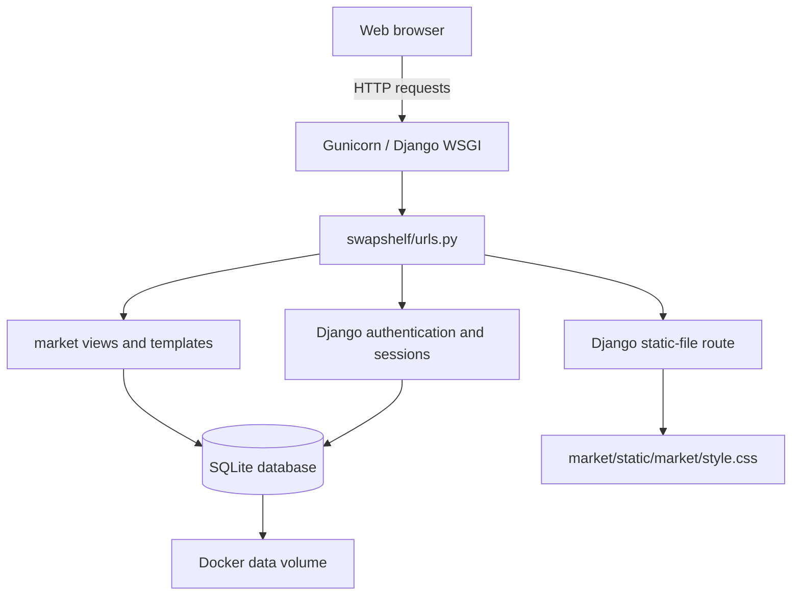
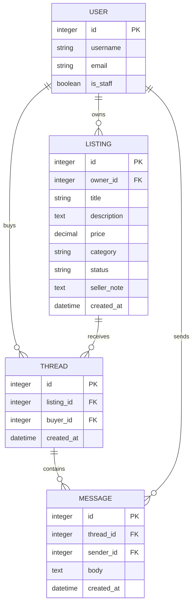
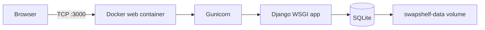

# SwapShelf Architecture

## System overview

SwapShelf is a server-rendered Django application. Browsers submit HTTP requests to
Gunicorn, which invokes the Django WSGI application. Django routes requests to the
market views, authentication views, or the static-file route. Views render HTML
templates and read or write application data in SQLite.

## Repository structure

| Component | Location | Responsibility |
|---|---|---|
| Django project configuration | `swapshelf/` | Settings, URL routing, WSGI entry point |
| Marketplace application | `market/` | Listings, profiles, messaging, desk page |
| Data models | `market/models.py` | `Listing`, `Thread`, and `Message` tables |
| Forms | `market/forms.py` | Listing and profile input validation |
| Templates | `market/templates/market/` | Server-rendered HTML pages |
| Static assets | `market/static/market/` | CSS served at `/static/` |
| Database | `data/swapshelf.db` | SQLite application data |
| Container setup | `Dockerfile`, `docker-compose.yml` | Python runtime, Gunicorn, persistent data volume |

## Request flow

1. A browser sends a request to the application on port `3000`.
2. Gunicorn loads `swapshelf.wsgi`.
3. `swapshelf/urls.py` routes the request:
   - `/admin/` to Django admin.
   - `/logout/` to Django's logout view.
   - `/static/<path>` to Django's static-file view.
   - All other application paths to `market/urls.py`.
4. A market view:
   - Checks authentication where required.
   - Loads or validates model data.
   - Applies authorization checks for protected mutations.
   - Renders a template or redirects.
5. Django's session middleware maintains the logged-in user's session.

## Main data model

## Authentication and authorization

- Public pages include the board and listing details.
- Registration and login use Django authentication.
- `@login_required` protects posting, profile, messaging, listing management,
  and the department desk.
- Listing edit, mark-sold, and delete operations query by both listing ID and
  `owner=request.user`, so only the poster can mutate a listing.
- The profile form intentionally excludes `User.is_staff`; users cannot promote
  themselves through the application.
- The desk view checks `request.user.is_staff`.
- Django admin remains available at `/admin/` for trusted staff accounts.

## Deployment

The container uses Python 3.12, installs the pinned dependencies, runs database
migrations and seed data on startup, and starts Gunicorn on `0.0.0.0:3000`.
The SQLite database is stored under `/app/data` and persists through the
`swapshelf-data` Docker volume.
